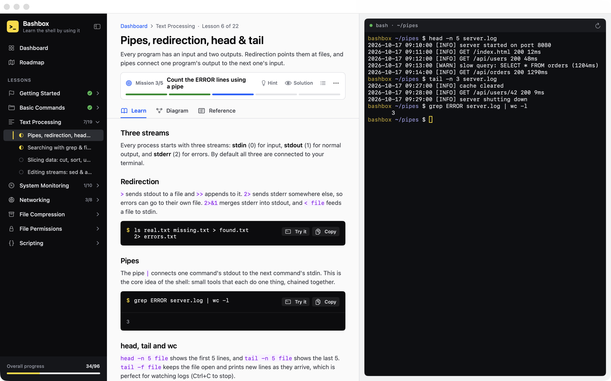

# Bashbox

Learn bash by using it. Bashbox is a Mac app with a real bash shell built in: read a short lesson, then complete missions in the terminal beside it, and Bashbox checks your work as you type.

**Website:** https://mmerioles.github.io/bashbox/



- 22 lessons and 96 missions across 8 topics, from the prompt to cron jobs
- A real `/bin/bash`, started in its own practice folder with one workspace per lesson
- A diagram and quick reference for every lesson

## Install

1. Download `Bashbox.dmg` from the [latest release](https://github.com/mmerioles/bashbox/releases/latest).
2. Open it and drag **Bashbox** to **Applications**.
3. On first launch, macOS will block the app because it isn't notarized. Open **System Settings → Privacy & Security** and click **Open Anyway** (on macOS 14, Control-click the app and choose **Open**).

Requires macOS 14 Sonoma or later, on Apple silicon or Intel.

## Develop

```sh
swift run          # build and launch
swift test         # run the curriculum and mission-check tests
```

Other tools:

| Command | What it does |
| --- | --- |
| `scripts/build-dmg.sh [version]` | Builds a universal `dist/Bashbox.app` and `dist/Bashbox.dmg` |
| `swift run Bashbox --screenshots docs/assets` | Renders the website screenshots from a throwaway demo workspace |
| `swift run Bashbox --export-diagrams DIR` | Writes every lesson diagram as a PNG |

## Releases and website

- **Website:** `docs/` is deployed to GitHub Pages by `.github/workflows/pages.yml` on every push to `main` that touches it. In the repo settings, set **Pages → Source** to **GitHub Actions**.
- **DMG:** pushing a tag like `v0.1.0` runs `.github/workflows/release.yml`, which builds the DMG and attaches it to a GitHub release.
